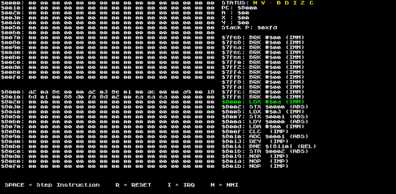

# crust-6502-emulator

A MOS 6502 CPU emulator in Rust, with a small debugger window. I wrote it over Christmas 2023
(first opcode on 24 December, first program running on the 31st) to learn how a CPU actually
executes code.



## What it does

- All 56 official 6502 instructions across 12 addressing modes, with cycle counts per opcode
  (illegal opcodes fall through to a no-op)
- Reset, IRQ and NMI
- A disassembler that turns memory back into readable assembly
- A debugger window (drawn with [minifb](https://crates.io/crates/minifb)) showing two pages of RAM,
  the registers and status flags, and the disassembly around the program counter

The built-in program multiplies 10 by 3 using a loop of additions and stores the result (30, `$1E`)
at address `$0002`:

```
A2 0A     LDX #$0A      ; x = 10
8E 00 00  STX $0000
A2 03     LDX #$03      ; y = 3
8E 01 00  STX $0001
AC 00 00  LDY $0000     ; loop counter = 10
A9 00     LDA #$00
18        CLC
6D 01 00  ADC $0001     ; a += 3
88        DEY
D0 FA     BNE -6
8D 02 00  STA $0002     ; result
```

## Run it

```sh
cargo run --release
```

| Key | Action |
|---|---|
| Space | Run the next instruction |
| R | Reset |
| Esc | Quit |

To run your own program, replace the hex string at the top of `main()` in `src/main.rs`.
It is loaded at `$8000`.

## Not done yet

- Run [Klaus Dormann's 6502 functional tests](https://github.com/Klaus2/6502_65C02_functional_tests)
- Split `main.rs` (about 3,000 lines) into CPU, bus, disassembler and UI modules
- Load programs from a file instead of a hard-coded string

Based on the 6502 design in javidx9's
[NES emulator series](https://www.youtube.com/playlist?list=PLrOv9FMX8xJHqMvSGB_9G9nZZ_4IgteYf).
